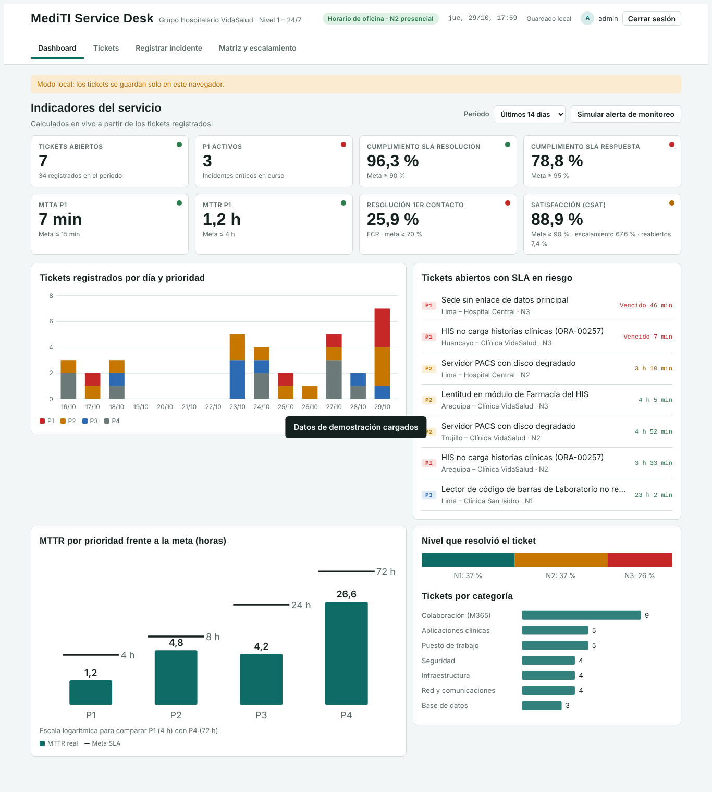
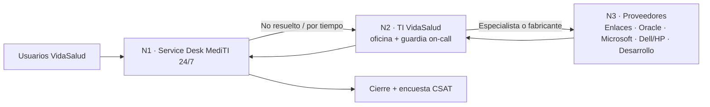
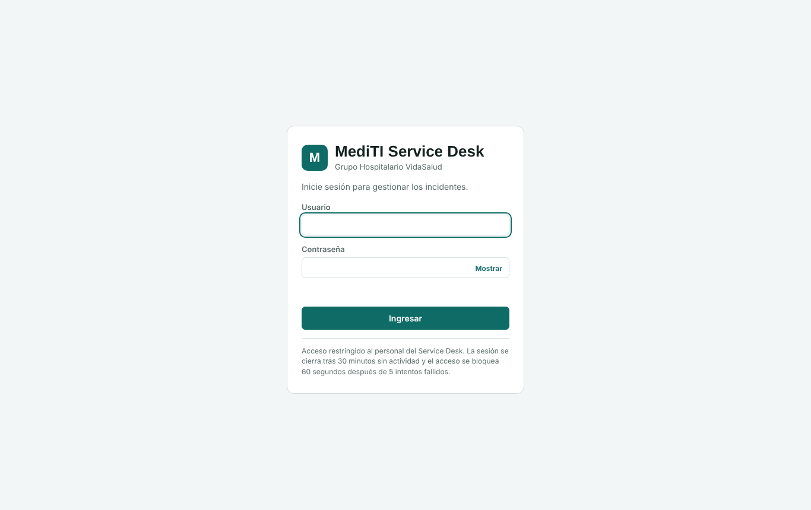
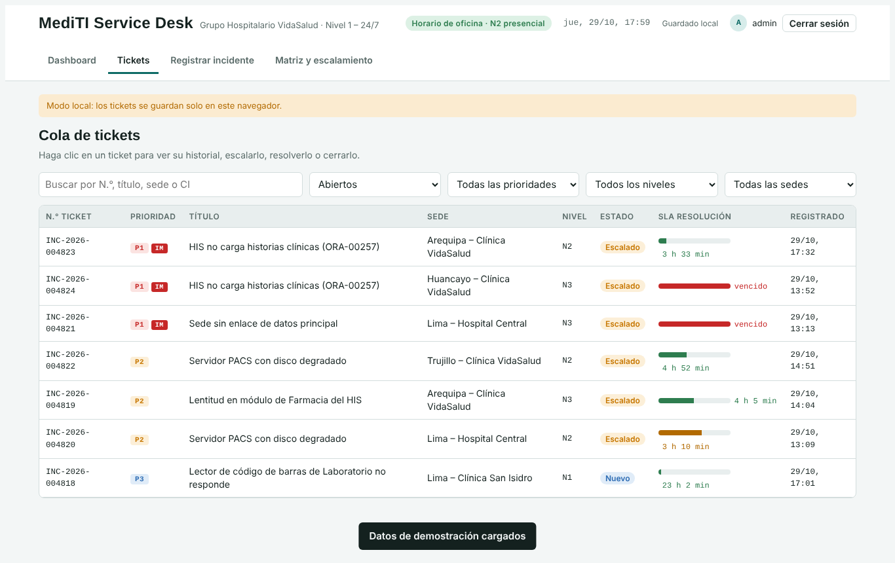
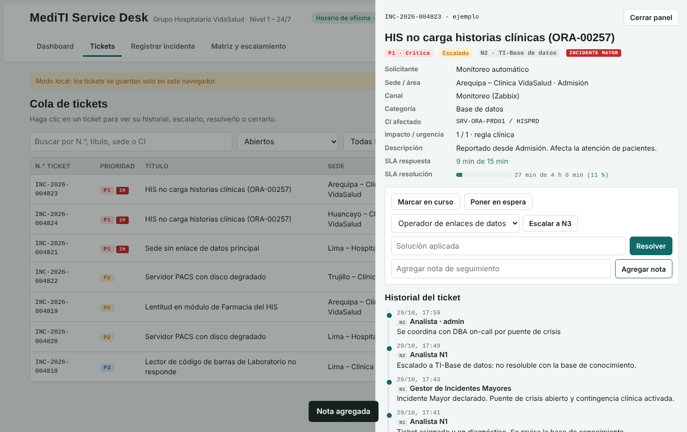
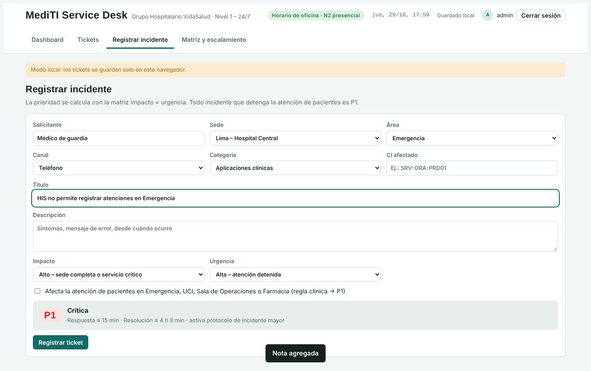
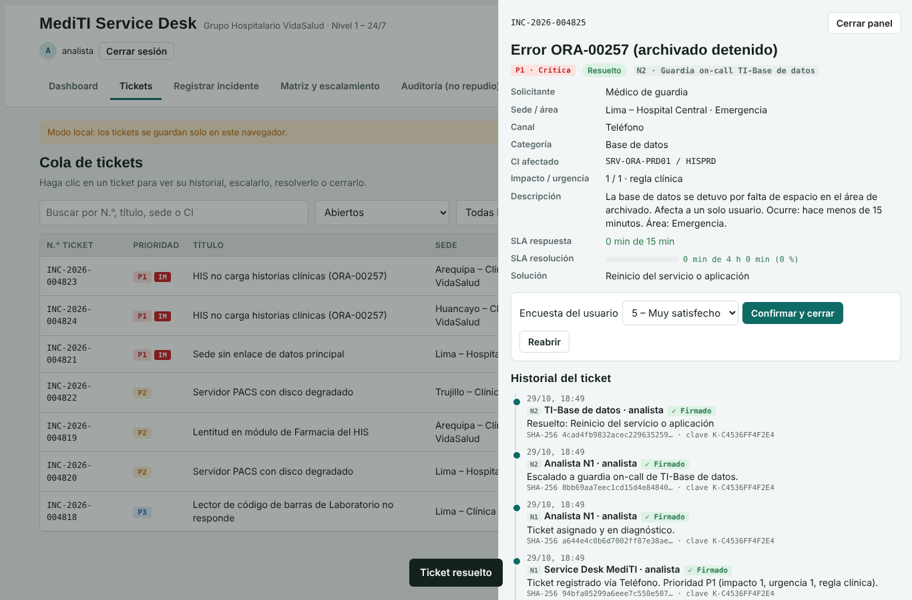
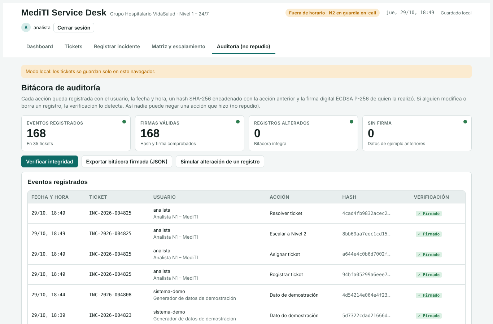

# MediTI Service Desk

Sistema web de **gestión de incidentes (Service Desk)** basado en **ITIL 4**, desarrollado para el caso práctico *MediTI – Grupo Hospitalario VidaSalud* del curso **PCBD-626 Gestión de Servicios y Gobernabilidad de TI** (SENATI, CFP Huancayo).

MediTI atiende el Nivel 1 del soporte TI 24/7 para hospitales y clínicas en Lima y provincias. El sistema registra, prioriza, escala y da seguimiento a los incidentes, y mide la efectividad del servicio con un dashboard de KPIs en tiempo real.



## Funcionalidades

| Módulo | Qué hace |
|---|---|
| **Inicio de sesión** | Acceso con usuario y contraseña. Las credenciales se validan con hash SHA-256 (no en texto plano), la sesión expira tras 30 min de inactividad y se bloquea el acceso 60 s después de 5 intentos fallidos. |
| **Dashboard** | 8 KPIs calculados en vivo con semáforo frente a su meta: tickets abiertos, P1 activos, cumplimiento de SLA de respuesta y resolución, MTTA y MTTR de P1, resolución en primer contacto (FCR) y satisfacción (CSAT). Gráficos de tickets por día y prioridad, MTTR frente a la meta, nivel de resolución y categorías. |
| **Registro de incidentes** | Se completa **solo con clics** (listas desplegables): solicitante, sede, área, categoría, incidente del catálogo, CI, alcance y tiempo. La descripción se genera sola. La prioridad se calcula automáticamente con la matriz **impacto × urgencia**. La regla clínica convierte en **P1** todo incidente que detenga la atención de pacientes (Emergencia, UCI, Sala de Operaciones, Farmacia). |
| **Cola de tickets** | Búsqueda y filtros por estado, prioridad, nivel y sede. Barra de SLA que cambia de verde a ámbar y rojo según el tiempo consumido. |
| **Detalle del ticket** | Ciclo de vida completo: asignar, en curso, en espera, escalar a **N2** (TI VidaSalud) o **N3** (proveedores), declarar **incidente mayor**, resolver, cerrar con encuesta o reabrir. Historial con fecha, hora, nivel y usuario. |
| **Soporte 24/7** | Detecta el horario: fuera de oficina el Nivel 2 se atiende por **guardia on-call**. Avisa cuando un ticket supera el tiempo máximo en Nivel 1. |
| **Monitoreo** | Botón que simula una alerta de **Zabbix** y crea el ticket automáticamente. |
| **Auditoría (no repudio)** | Cada acción se firma digitalmente (ECDSA P-256) con la clave del usuario y se encadena con un hash SHA-256. La bitácora muestra quién hizo qué y cuándo, verifica la integridad, detecta cualquier alteración y se exporta firmada en JSON. |
| **Matriz y escalamiento** | Referencia de la matriz de prioridad, SLA y los tres niveles de soporte. |

## Acceso

| Usuario | Contraseña | Rol |
|---|---|---|
| `admin` | `admin` | Administrador del Service Desk |
| `analista` | `analista` | Analista N1 – MediTI |
| `supervisor` | `supervisor` | Coordinador del Service Desk |

Cada usuario tiene su propia cuenta y su propia clave de firma, para que cada acción quede atribuida a una persona.

> Credenciales de demostración para fines académicos. En un entorno real se reemplazarían por autenticación del lado del servidor (Active Directory / Entra ID con MFA).

## No repudio

El sistema garantiza que ningún usuario pueda negar una acción que realizó sobre un ticket:

| Mecanismo | Cómo se aplica |
|---|---|
| **Identificación individual** | Cada persona entra con su propia cuenta; las acciones registran usuario y rol. |
| **Firma digital** | Al iniciar sesión por primera vez se genera un par de claves **ECDSA P-256** (Web Crypto API). La clave privada se guarda cifrada con la contraseña del usuario (**PBKDF2 + AES-GCM 256**) y solo se abre en memoria durante la sesión. |
| **Sello de tiempo y hash** | Cada evento guarda fecha y hora, y un **hash SHA-256** de su contenido. |
| **Cadena de integridad** | Cada hash incluye el hash del evento anterior del mismo ticket, como en un blockchain: si se borra o modifica un registro, la cadena se rompe. |
| **Huella del estado** | La última acción firmada guarda la huella del estado del ticket; si alguien cambia la prioridad o el estado fuera del sistema, se detecta. |
| **Confirmación expresa** | Las acciones críticas (escalar, incidente mayor, resolver, cerrar, reabrir) muestran un aviso de «Firmar y confirmar». |
| **Bitácora solo de anexión** | No existe opción para editar ni borrar eventos. |
| **Verificación independiente** | Con el registro de claves públicas cualquiera puede comprobar las firmas. La bitácora se exporta en JSON con hashes y firmas como evidencia. |

En la pestaña **Auditoría (no repudio)**, el botón **Simular alteración de un registro** modifica un evento sin firmarlo para demostrar que la verificación lo detecta (✗ Alterado).

> **Alcance académico:** en producción el no repudio se reforzaría con certificados digitales emitidos por una entidad acreditada (Ley N.° 27269 de Firmas y Certificados Digitales del Perú), sellado de tiempo de una TSA y almacenamiento de la bitácora en un servidor de solo escritura.

## Acuerdos de nivel de servicio (SLA)

| Prioridad | Respuesta | Resolución | Escalar N1 → N2 |
|---|---|---|---|
| P1 – Crítica | 15 min | 4 h | Inmediato |
| P2 – Alta | 30 min | 8 h | 15 min |
| P3 – Media | 2 h | 24 h | 30 min |
| P4 – Baja | 4 h | 72 h | 1 h |

## Esquema de escalamiento



## Ejecución local

No requiere instalación ni servidor: es HTML, CSS y JavaScript puro.

1. Descargue o clone el repositorio:
   ```bash
   git clone https://github.com/<su-usuario>/mediti-service-desk.git
   ```
2. Abra `index.html` en el navegador (doble clic), o levante un servidor local:
   ```bash
   python -m http.server 8000
   ```
   y visite `http://localhost:8000`.
3. Ingrese con `admin / admin` y pulse **Cargar datos de demostración** para ver el dashboard con 34 tickets de ejemplo.

Los tickets se guardan en el `localStorage` del navegador.

## Publicar con GitHub Pages

1. En el repositorio: **Settings → Pages**.
2. En *Source* elija **Deploy from a branch**, rama `main` y carpeta `/ (root)`.
3. Guarde. En uno o dos minutos el sistema estará en `https://<su-usuario>.github.io/mediti-service-desk/`.

## Estructura

```
mediti-service-desk/
├── index.html          Interfaz: login, dashboard, tickets, registro y matriz
├── css/styles.css      Estilos (tema claro y oscuro, adaptable a móvil)
├── js/catalogos.js     Matriz de prioridad, SLA, catálogos y datos de demostración
├── js/app.js           Lógica: tickets, escalamiento, KPIs, gráficos y autenticación
└── docs/img/           Capturas de pantalla
```

## Capturas

| Inicio de sesión | Cola de tickets |
|---|---|
|  |  |
| **Detalle y escalamiento** | **Registro con prioridad automática** |
|  |  |
| **Acciones firmadas** | **Bitácora de auditoría** |
|  |  |

## Tecnologías y marco de referencia

- HTML5, CSS3 y JavaScript (sin frameworks ni dependencias).
- Gráficos SVG generados por código.
- Web Crypto API: SHA-256 (credenciales y cadena de hashes), ECDSA P-256 (firma digital), PBKDF2 + AES-GCM (protección de la clave privada).
- Prácticas ITIL 4: Service Desk, Gestión de Incidentes, Gestión de Niveles de Servicio, Gestión de Proveedores, Monitoreo y Gestión de Eventos.

## Autor

**Jeferson Mantari Huaman** – Ingeniería de Ciberseguridad, SENATI CFP Huancayo
Curso PCBD-626 · Instructor: Jhon Zapata Torres · 2026

## Licencia

Distribuido bajo licencia MIT. Ver [LICENSE](LICENSE).
